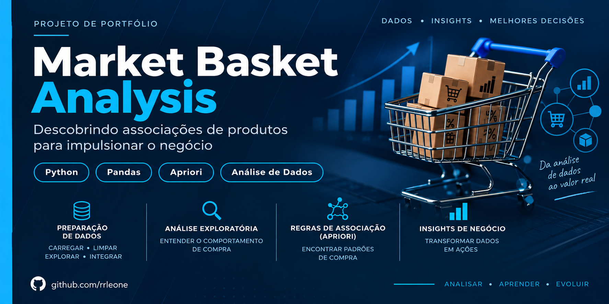

<div align="center">

<h1>Market Basket Analysis — Instacart</h1>

<h3>Market Basket Analysis · Product Associations · Customer Behavior</h3>

<p>
  
  
  
  
  
</p>

<p>
  <strong>Identificando padrões de compra e associações entre produtos para apoiar estratégias comerciais.</strong>
</p>



</div>

---

## Visão geral do projeto

O **Market Basket Analysis — Instacart** é um projeto de Análise de Dados desenvolvido em Python para investigar padrões de compra e identificar associações entre produtos adquiridos em uma mesma transação.

A partir do histórico de pedidos do dataset Instacart, o projeto transforma dados transacionais em informações que podem apoiar estratégias de recomendação, cross-selling, composição de ofertas e compreensão do comportamento de compra.

O trabalho percorre etapas de exploração, preparação das transações, aplicação de algoritmos de associação e interpretação dos resultados sob a perspectiva de negócio.

**DATA ANALYTICS · ASSOCIATION RULES · BUSINESS INSIGHTS**

Dados → Exploração → Cestas de Compra → Apriori → Regras de Associação → Insights

---

## Problema de negócio

Em operações de e-commerce, compreender quais produtos são frequentemente adquiridos juntos pode ajudar a identificar oportunidades comerciais.

A análise isolada de produtos e pedidos não revela necessariamente essas relações. O Market Basket Analysis permite investigar associações entre itens presentes na mesma cesta de compra.

O projeto busca responder:

- Quais produtos aparecem frequentemente nas mesmas transações?
- Quais associações apresentam maior força?
- Quais produtos podem ser considerados em estratégias de cross-selling?
- Como as métricas de associação ajudam a interpretar o comportamento de compra?
- Quais combinações podem ser exploradas em recomendações e ofertas?

---

## Objetivos analíticos

Identificar regras de associação entre produtos utilizando o algoritmo **Apriori**, avaliando as relações por meio de:

- Support
- Confidence
- Lift

O objetivo é explorar padrões de compra e traduzir os resultados matemáticos em possíveis aplicações comerciais.

---

## Dados utilizados

O projeto utiliza o **Instacart Market Basket Analysis**, conjunto de dados que contém informações sobre pedidos, produtos, departamentos e corredores.

### Principais arquivos

| Arquivo | Descrição |
|---|---|
| `aisles.csv` | Corredores e categorias de produtos |
| `departments.csv` | Departamentos |
| `orders.csv` | Informações dos pedidos |
| `products.csv` | Cadastro de produtos |
| `order_products__prior.csv` | Produtos associados a pedidos anteriores |
| `order_products__train.csv` | Produtos associados ao conjunto de treino |

A tabela `order_products__prior.csv` é a principal fonte transacional utilizada para construir as cestas de compra.

> **Dados brutos:** os arquivos originais não são armazenados no repositório devido ao tamanho do dataset. Para reproduzir a análise, é necessário obter os dados originais e disponibilizá-los na pasta `dados/`.

---

## Metodologia

O projeto segue um fluxo analítico estruturado:

1. Carregamento dos dados;
2. Inspeção das tabelas;
3. Análise exploratória;
4. Verificação de valores ausentes;
5. Integração das tabelas;
6. Análise de pedidos, produtos, departamentos e recompra;
7. Construção das cestas de produtos;
8. Aplicação do algoritmo Apriori;
9. Avaliação das regras de associação;
10. Interpretação dos resultados sob a perspectiva de negócio.

### Exploração e preparação

Foram analisadas as tabelas do dataset para compreender a estrutura dos pedidos, os produtos e suas relações.

A tabela de produtos por pedido foi utilizada para agrupar os itens por `order_id`, formando as cestas de compra.

### Formação das transações

Cada pedido representa uma transação contendo os produtos adquiridos conjuntamente.

Após a preparação, o projeto registrou:

**3.214.874 transações**

### Aplicação do algoritmo Apriori

Para controlar o processamento, o algoritmo Apriori foi aplicado sobre uma amostra de **500.000 transações**.

Foram avaliadas duas configurações:

| Configuração | Support mínimo | Confidence mínimo |
|---|---:|---:|
| Cenário 1 | 0,01 | 0,20 |
| Cenário 2 | 0,005 | 0,20 |

A comparação permite explorar regras com diferentes níveis de frequência mínima.

---

## Métricas de associação

### Support

Representa a proporção de transações que contém simultaneamente os itens de uma associação.

Indica a frequência com que uma combinação aparece no conjunto analisado.

### Confidence

Para uma regra `A → B`, representa a proporção de transações que contêm o produto B entre as transações que contêm A.

Ajuda a avaliar a frequência condicional da associação.

### Lift

Compara a ocorrência conjunta dos produtos com a ocorrência esperada considerando suas frequências individuais.

| Lift | Interpretação |
|---|---|
| **Lift > 1** | Associação positiva |
| **Lift = 1** | Ausência de associação adicional |
| **Lift < 1** | Associação negativa |

O Lift permite avaliar se a ocorrência conjunta dos produtos é superior ou inferior à esperada considerando suas frequências individuais.

---

## Principais resultados

Entre as regras identificadas na análise, destacam-se:

| Produto A | Produto B | Confidence | Lift |
|---|---|---:|---:|
| Organic Cilantro | Limes | 25,04% | **5,74** |
| Organic Garlic | Organic Yellow Onion | 20,11% | **5,69** |
| Organic Lemon | Organic Hass Avocado | 23,99% | **3,62** |
| Organic Cucumber | Organic Hass Avocado | 21,54% | **3,25** |
| Organic Raspberries | Organic Strawberries | 24,86% | **3,01** |

As associações apresentadas possuem Lift superior a 1, indicando associação positiva entre os produtos na amostra analisada.

**Importante:** associação não significa causalidade. Os resultados indicam padrões observados nas transações, não que a compra de um produto cause a compra do outro.

---

## Insights e aplicações de negócio

Os resultados do Market Basket Analysis podem apoiar diferentes estratégias comerciais.

### Cross-selling

Identificar produtos que apresentam associação positiva e avaliar oportunidades de recomendação conjunta.

### Recomendação de produtos

Utilizar regras de associação como uma possível fonte de informação para sistemas de recomendação.

### Combinações comerciais

Explorar associações para investigar possíveis combinações de produtos e ofertas.

### Experiência de compra

Utilizar padrões de compra para apoiar a organização de recomendações e facilitar a descoberta de produtos relacionados.

### Considerações para aplicação real

As regras de associação não devem ser utilizadas isoladamente. Uma aplicação comercial exigiria considerar também:

- Margem dos produtos;
- Estoque e disponibilidade;
- Preço;
- Sazonalidade;
- Contexto da operação;
- Validação dos resultados em dados adicionais.

---

## Tecnologias e ferramentas

| Tecnologia | Aplicação |
|---|---|
| **Python** | Linguagem principal da análise |
| **Jupyter Notebook** | Desenvolvimento e documentação do fluxo analítico |
| **Pandas** | Manipulação e análise de dados |
| **NumPy** | Operações numéricas |
| **Matplotlib** | Visualização de dados |
| **Efficient Apriori** | Aplicação do algoritmo Apriori e geração de regras |
| **Watermark** | Registro de informações do ambiente notebook |

---

## Estrutura do projeto

```text
Market-Basket-Analysis/
│
├── README.md
├── notebooks/
│   └── MBA.ipynb
│
├── reports/
│   └── MBA.pdf
│
├── dados/
│   └── README.md
│
└── requirements.txt
```

---

## Como executar

1. Obtenha os arquivos originais do dataset Instacart Market Basket Analysis.
2. Disponibilize os arquivos CSV na pasta `dados/`.
3. Configure um ambiente Python.
4. Instale as dependências listadas em `requirements.txt`.
5. Abra `notebooks/MBA.ipynb` no Jupyter Notebook.
6. Execute as células na ordem apresentada.

A execução integral depende da disponibilidade dos arquivos originais, especialmente `order_products__prior.csv`.

---

## Reprodutibilidade e validação

Os resultados apresentados foram auditados quanto à consistência metodológica e matemática com base no notebook e nos outputs registrados.

As métricas de associação foram verificadas a partir das fórmulas utilizadas no projeto.

A execução integral do notebook não foi refeita nesta revisão, pois o arquivo original `order_products__prior.csv` não estava disponível no ambiente de trabalho.

Portanto, esta documentação **não afirma que os resultados foram reexecutados independentemente** nesta etapa.

---

## Materiais do projeto

- **Notebook:** `notebooks/MBA.ipynb` — análise completa em Jupyter Notebook.
- **Relatório:** `reports/MBA.pdf` — documentação da análise e dos resultados.

---

## Autor

**Renato Leone**  
Analista de Dados | Business Intelligence

Projeto desenvolvido para demonstrar a aplicação prática de técnicas de **Análise de Dados, comportamento de compra e Market Basket Analysis com Python**.

---

<div align="center">

**MARKET BASKET ANALYSIS — INSTACART**

Dados · Padrões de Compra · Associação · Insights

**RENATO LEONE | DATA ANALYTICS & BUSINESS INTELLIGENCE**

</div>
